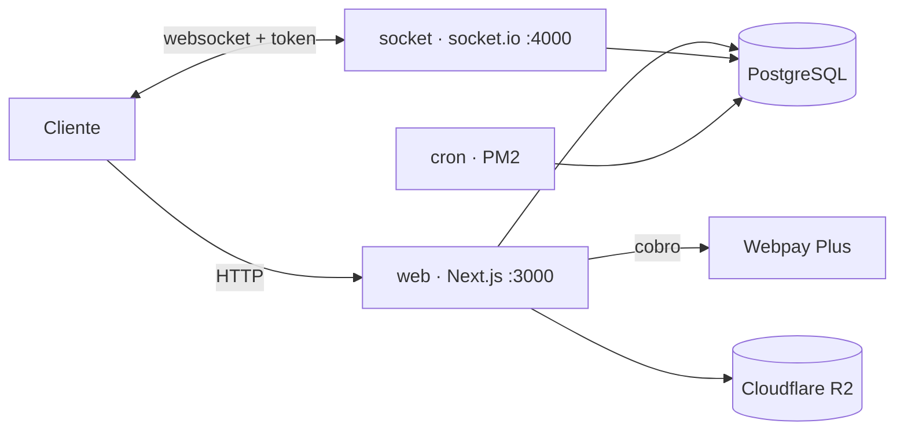

# RedFreelance

Marketplace de servicios freelance para el mercado chileno: publicar un servicio,
comparar paquetes, pagar y coordinar todo con el cliente sin salir de la plataforma.

Proyecto personal hecho de punta a punta —modelo de datos, API, frontend, servidor
en tiempo real y despliegue— entre julio de 2025 y octubre de 2026.
**167 commits · 12 páginas · 38 endpoints · 20 migraciones de base de datos.**

## El recorrido

1. Un freelancer crea un **gig** con uno o más **paquetes de precio** (`GigTier`) y lo
   clasifica en categorías.
2. El comprador busca por título o navega por categoría, compara y **solicita** el
   servicio (`TransactionRequest`).
3. El freelancer **acepta** y se abre una **transacción** con su historial de estados
   (`Lifecycle`).
4. El comprador **paga con Webpay Plus**; el pago se verifica al volver del banco.
5. Si nadie paga a tiempo, un worker marca la transacción como expirada.

## Lo que está construido

- **Gigs** — creación, edición, paquetes de precio, categorías, búsqueda por título y
  navegación por categoría.
- **Transacciones** — solicitud, aceptación, historial de estados y cierre, con
  expiración automática de las que quedan sin pago.
- **Pagos** — Webpay Plus de Transbank, desde la creación del cobro hasta la
  verificación al volver del banco.
- **Chat** — una conversación por transacción, en tiempo real.
- **Perfil** — datos del usuario, sus gigs publicados y sus transacciones.
- **Blog** — publicaciones con categorías.

## Decisiones técnicas

**El servidor de socket vive aparte del frontend.** Next se encarga de HTTP y
renderizado; el tiempo real corre en un proceso propio en el puerto 4000. El cliente
no se conecta directo: pide un token de sesión al backend de Next y lo presenta al
conectar, así el servidor de socket sabe quién habla sin duplicar la lógica de
NextAuth.

**Un worker se hace cargo del tiempo.** Toda transacción tiene plazo. Un proceso PM2
(`expire-transactions-cron`) revisa la base y marca como expiradas las que quedaron
sin pago, sin depender de que alguien abra una página.

**Las imágenes nunca pasan por el servidor.** El cliente pide una URL firmada al
backend, sube directo a Cloudflare R2 con una vigencia de 5 minutos y la imagen se
sirve desde el CDN. El contenedor de Next queda sin estado y sin límite de payload.

**El pago es un ida y vuelta con el banco.** Se crea la transacción en Webpay, se
redirige al usuario, y al volver se verifica el resultado antes de marcarla como
pagada. El estado nunca se toma de lo que diga el cliente.

**La validación migra a Zod.** Nueve de los 38 endpoints ya validan la entrada con
un schema antes de tocar Prisma; el resto se escribió antes de esa decisión y quedó
pendiente de migrar.

## Stack

| Capa | Tecnología |
|---|---|
| Frontend | Next.js 15 (App Router), React 19, TypeScript, Tailwind CSS, Radix UI |
| Backend | Route Handlers de Next, Prisma 7 con `adapter-pg`, Zod |
| Base de datos | PostgreSQL 15 |
| Auth | NextAuth con Google OAuth |
| Tiempo real | socket.io en proceso dedicado |
| Pagos | Webpay Plus vía SDK de Transbank |
| Archivos | Cloudflare R2 |
| Infra | Docker Compose + PM2 para el worker |

## Arquitectura



Cuatro contenedores: `db`, `web`, `socket` y `cron`. Las imágenes están publicadas en
Docker Hub, y el servicio `web` aplica las migraciones y el seed al arrancar.

## Cómo correr

```bash
git clone git@github.com:Jared1399/RedFreelance.git
cd RedFreelance
cp .env.example .env        # completar credenciales

docker compose up -d db
npm install
npx prisma migrate dev
npm run prisma:seed
npm run dev                 # Next en :3000

node socketServer.js        # chat en :4000, en otra terminal
```

O todo junto con `docker compose up --build`, usando las imágenes ya publicadas.

## Estado

Completo y funcional de punta a punta: lo que falta es despliegue, no código. No hay
demo pública por ahora —el dominio está reservado y el despliegue apagado—, pero se
levanta entero con los pasos de arriba.

Los pagos corren sobre el entorno de integración de Transbank: el flujo completo está
implementado sin mover dinero real, y el `.env.example` trae las credenciales públicas
de ese entorno. La validación de entrada está migrando a Zod (9 de 38 endpoints) y
todavía no hay suite de tests automatizados.

**Pendiente:** el modelo de datos declara 20 tablas, pero likes, feedback,
notificaciones, portafolio, comentarios del blog y avisos quedaron modelados sin UI.
Están ahí como base para lo siguiente, no como funcionalidad.

## Licencia

Sin licencia por ahora: el código es visible con fines de portafolio y todos los
derechos quedan reservados al autor.
